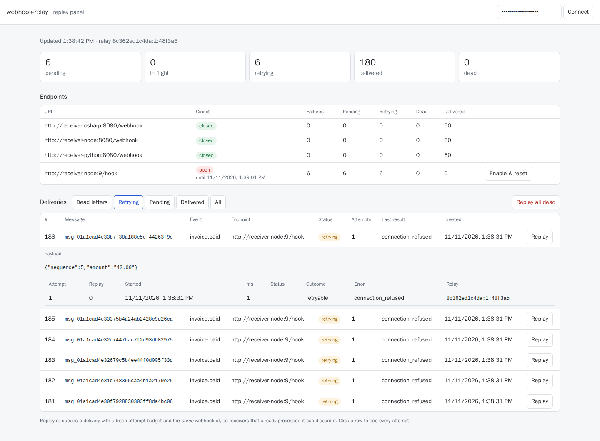
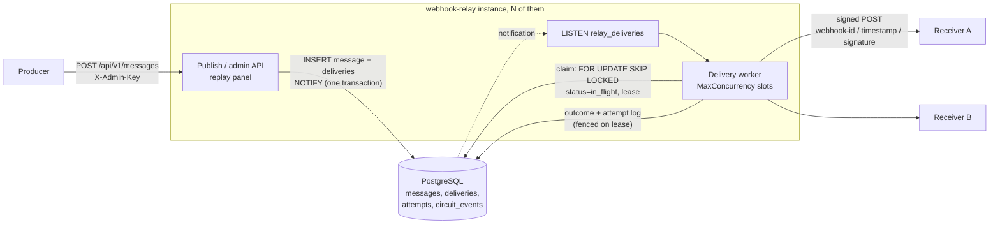
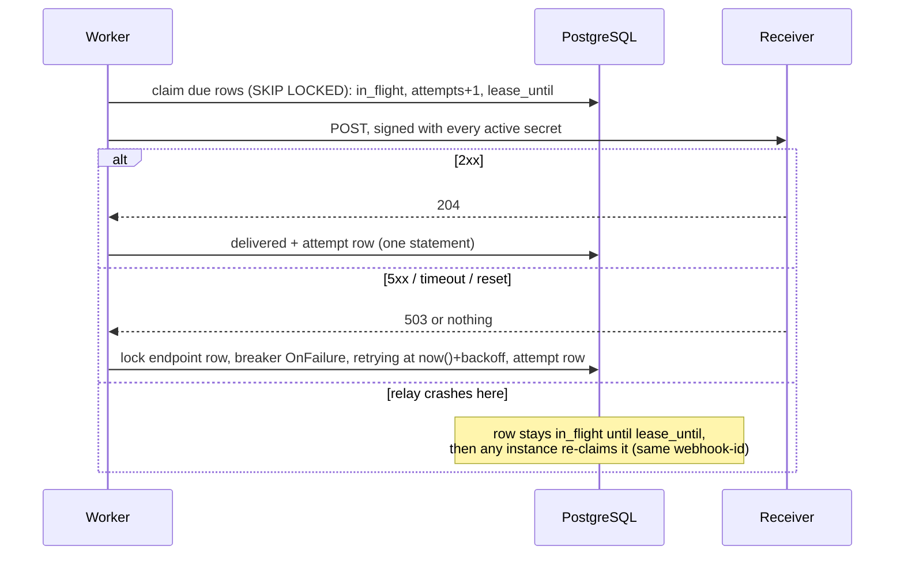

# webhook-relay

[](https://github.com/hekimcan206/webhook-relay/actions/workflows/ci.yml)
[](https://github.com/hekimcan206/webhook-relay/actions/workflows/codeql.yml)


[](LICENSE)

A webhook delivery service in .NET 10. Producers publish events once; the relay signs them with
[Standard Webhooks](https://www.standardwebhooks.com/) signatures and delivers them to every subscribed endpoint, with a
durable PostgreSQL queue, exponential backoff with jitter, a per-endpoint circuit breaker, a dead-letter queue and a
replay panel. The promise is **at-least-once delivery with bounded, detectable duplicates**, and the repository is built
around proving it: receivers that time out, fail, drop the connection or crawl, and a relay process that is killed hard
in the middle of delivering.

All data in this repository is synthetic; there is no real personal or business data.

## The problem

Sending a webhook is one HTTP call. Delivering webhooks reliably is not:

- the receiver is down for an hour, or for three days, or only every other minute;
- it processes the event and then times out, so you cannot know whether it got it;
- your own process crashes between "the receiver said 200" and "we wrote that down";
- one dead endpoint with 50,000 queued events must not slow everyone else down;
- receivers need to verify the request came from you, was not altered and is not a replay;
- a tenant registers `http://169.254.169.254/` as their endpoint.

## What it does

| Concern | How |
|---|---|
| Signing | Standard Webhooks `v1`: `webhook-id`, `webhook-timestamp`, `webhook-signature` = HMAC-SHA256 over `id.timestamp.body` with `whsec_` secrets. Rotation signs with old and new secrets at once; verification accepts any match within ±5 min. Reproduces the reference test vector. |
| Queue | PostgreSQL table claimed with `FOR UPDATE SKIP LOCKED` and leases; fan-out and enqueue in one statement; LISTEN/NOTIFY wake-ups. |
| Crash recovery | A delivery claimed by a dead process becomes claimable when its lease expires; outcome writes are fenced so a stale result never overwrites a newer one. |
| Retries | Exponential backoff (10 s × 3ⁿ, cap 12 h, 14 attempts, about 2.7 days) with ±25% jitter; `Retry-After` honoured within the cap; 410 disables the endpoint. |
| Circuit breaker | Per endpoint, stored on the endpoint row so all instances share it; one probe across the cluster; time spent open does not burn attempts. |
| Dead letters and replay | Exhausted deliveries stay queryable; replay one or all from the panel or API, with the same `webhook-id`. |
| SSRF | Resolved IPs checked at connect time (private, loopback, link-local, CGNAT, ULA, embedded IPv4 refused); redirects never followed. |
| Receivers | From-scratch verifiers in **C#, Node and Python** (stdlib only), tested in CI against signatures the relay generated in the same job. |



## Architecture



One delivery, including the failure paths:



## Why this design

- **PostgreSQL as the queue** ([ADR 0001](docs/adr/0001-postgresql-as-the-durable-delivery-queue.md)): per-delivery
  schedules over days, pausing one endpoint, and queryable history for the replay panel are all natural in SQL, and
  `SKIP LOCKED` gives exclusive claims without blocking. One system to operate. The cost is throughput bounded by commits.
- **Standard Webhooks, not a home-grown header** ([ADR 0002](docs/adr/0002-standard-webhooks-signatures-and-rotation.md)):
  receivers can use any compliant library; payloads are stored as text so the signed bytes are the sent bytes.
- **Proportional jitter** ([ADR 0003](docs/adr/0003-exponential-backoff-with-proportional-jitter.md)): keeps the schedule
  explainable while spreading a 10,000-delivery herd to a peak of 254/s (measured).
- **Breaker state in the database** ([ADR 0004](docs/adr/0004-per-endpoint-circuit-breaker-in-the-database.md)): an
  in-process breaker would give N independent breakers for N instances and forget everything on restart.
- **At-least-once, deduplicate by id** ([ADR 0005](docs/adr/0005-at-least-once-delivery-and-receiver-idempotency.md)):
  exactly-once across HTTP does not exist; the relay bounds duplicates and makes every one carry the original id.
- **Egress policy and real-fault tests** ([ADR 0006](docs/adr/0006-egress-policy-and-fault-injection-testing.md)).

## Quick start

```bash
docker compose up
```

That starts PostgreSQL (least-privilege roles), a one-shot migrator, the relay on `http://127.0.0.1:59480`, three
receivers (C#, Node, Python) and a demo driver. The driver registers the receivers, publishes 60 events, waits for the
queue to drain, replays one delivery, and checks each receiver's own counters. Its last line looks like this
(measured run):

```json
{"ok":true,"messages":60,"seconds":6,"relay":{"pending":0,"in_flight":0,"retrying":0,"delivered":180,"dead":0},
 "receivers":{"csharp":{"processed":60,"duplicatesDetected":0,"retriedOnPurpose":0,"rejected":0},
              "node":{"processed":60,"duplicatesDetected":1,"retriedOnPurpose":0,"rejected":0},
              "python":{"processed":60,"duplicatesDetected":0,"retriedOnPurpose":20,"rejected":0}},"failures":[]}
```

The Python receiver answers 503 to the first attempt of every third message (20 retries, all processed once); the
replayed delivery reached the Node receiver with a `webhook-id` it had already processed and was discarded.

Open `http://127.0.0.1:59480/` for the replay panel (key `admin-dev-only-key`) and `/scalar/v1` for the API reference.

```bash
# register an endpoint (the secret is returned once)
curl -s -X POST localhost:59480/api/v1/endpoints -H 'X-Admin-Key: admin-dev-only-key' \
     -H 'content-type: application/json' -d '{"url":"http://receiver-node:8080/webhook","eventTypes":["invoice.paid"]}'
# publish
curl -s -X POST localhost:59480/api/v1/messages -H 'X-Admin-Key: admin-dev-only-key' \
     -H 'content-type: application/json' -d '{"eventType":"invoice.paid","payload":{"invoiceId":"inv_1"},"idempotencyKey":"inv_1-paid"}'
# dead letters, and replay them all
curl -s 'localhost:59480/api/v1/deliveries?status=dead' -H 'X-Admin-Key: admin-dev-only-key'
curl -s -X POST localhost:59480/api/v1/deliveries/replay-dead -H 'X-Admin-Key: admin-dev-only-key' -H 'content-type: application/json' -d '{}'
```

Development: `dotnet run --project src/WebhookRelay.Server` uses the compose PostgreSQL on port 59432
(`appsettings.Development.json`). Tests: `dotnet test` (Docker running).

## Receiving webhooks (idempotency guidance)

1. **Verify first, over the raw body.** Never re-serialise parsed JSON before verifying.
2. **Deduplicate by `webhook-id`.** Store it with a unique constraint in the same transaction as your side effect, and
   keep it for longer than the retry window (about 3 days by default; 4 days is the maximum message age). A short cache
   TTL does not cover multi-day retries.
3. **Answer 2xx fast** and do slow work asynchronously: a receiver that times out turns its own slowness into
   duplicates.
4. **Do not rely on order.** Retries and concurrent attempts reorder events; use versions or timestamps in the payload.
5. **Answer 410 only to unsubscribe permanently.** It disables the endpoint.

The samples show all of this; each verifier is a few dozen lines:
[C#](samples/receiver-csharp/StandardWebhooks.cs) · [Node](samples/receiver-node/standard-webhooks.mjs) ·
[Python](samples/receiver-python/standard_webhooks.py).

## Delivery guarantees, as tested

| Test (integration, real PostgreSQL and sockets) | Asserts |
|---|---|
| Receiver returns 503 twice, then 200 | Delivered on attempt 3; gaps respect the backoff band |
| Receiver processes, then answers after the timeout | Exactly one duplicate, same `webhook-id`, valid signature |
| Receiver closes the connection | Retried (`connection_reset`), delivered |
| Receiver slow but within the timeout | Delivered once, no retries |
| 300 messages under a seeded mix of 500/503/resets/timeouts/slow | All 300 processed; duplicates ≤ timed-out attempts; 0 invalid signatures |
| Permanent 500 | Dead after max attempts; replay delivers it with the same id |
| 410 Gone | Endpoint disabled, delivery dead, new events skip it |
| 429 with `Retry-After: 2` | Next attempt ≥ 2 s later despite a 200 ms backoff |
| Endpoint down | Circuit opens, no traffic while open, single probe, closes on recovery, backlog keeps its attempt budget |
| Two relay instances, one queue | 200 messages, 0 duplicates, both instances worked |
| **Relay process killed hard twice mid-delivery** (300 messages, 16 in flight) | All 300 processed; duplicates ≤ deliveries in flight at the kills |
| Registration of `127.0.0.1`, `169.254.169.254`, `[::1]`, credentials in URL | Rejected; `localhost` slipped in via SQL is blocked at connect time |

## Measured results

Laptop (i7-13620H), PostgreSQL 17 in Docker Desktop with default (durable) settings, relay and receiver in one process,
**another project's Oracle and PostgreSQL containers busy on the same machine**. Method and raw numbers:
[docs/benchmarks.md](docs/benchmarks.md).

| Metric | Result |
|---|---|
| Delivery throughput, 1 endpoint, concurrency 64 (median of 3 × 20,000) | **2,064 deliveries/s** (1,457 before the single-statement success path) |
| Delivery throughput, 10 endpoints, concurrency 128 | **2,456 deliveries/s** (1,476 before) |
| Enqueue → delivery at 50 / 200 / 500 msg/s (NOTIFY) | p50 **6.5 / 7.3 / 9.2 ms**, p95 15.4 / 21.6 / 50.0 ms |
| Enqueue → delivery at 50 msg/s, polling only (1 s) | p50 510 ms, p95 976 ms |
| Default retry schedule, time to last retry (100k samples) | p50 65.5 h (p5 61.2 h, p95 69.0 h) |
| Herd of 10,000 failing together, retry 3 | peak 10,000/s without jitter, **254/s** proportional, 134/s full |
| Observed retry gaps vs configured band (200 deliveries × 5 gaps) | 0 early; late by ≤ 135 ms at p95 (poll interval 100 ms) |
| Flapping endpoint (3 s up / 3 s down), attempts against the down endpoint | **31** with breaker vs **1,360** without (mean of 2 runs); p50 latency 520 ms vs 139 ms, p95 3.2 s vs 3.9 s |
| Sign / verify, 1 KiB body | 1.43 µs / 1.58 µs |

Tests: 119 unit, property and golden tests; 28 integration tests (Testcontainers PostgreSQL, real receivers, process
kills); 23 Node and 2 Python test cases (22 vectors each) in CI.

## Project layout

```
src/WebhookRelay.Signing     Standard Webhooks signer/verifier (no dependencies)
src/WebhookRelay.Core        retry policy, circuit breaker, outcome classification, egress policy (pure)
src/WebhookRelay.Server      API, delivery worker, PostgreSQL store, migrations, replay panel (wwwroot)
samples/receiver-*           C#, Node, Python receivers; samples/vectors: relay-generated signature vectors
tests/                       unit/property/golden tests, TestKit (fault-injecting receiver), integration tests
benchmarks/                  throughput, latency, retry, breaker scenarios; BenchmarkDotNet signing benchmarks
```

## Limitations and next steps

- **Signing secrets are stored unencrypted** in PostgreSQL (HMAC needs the key). Envelope encryption with a KMS key is
  the fix; `v1a` (Ed25519) signatures would also let receivers hold only a public key.
- **Single shared admin key.** No per-producer identity, scopes or audit of who replayed what; OIDC is the next step.
- **Throughput is commit-bound** (about 2,000 deliveries/s on this laptop). Batching outcome writes across deliveries,
  or a broker in front for very high volume, would raise it. Multi-instance throughput was not measured.
- **The breaker counts consecutive failures.** A receiver that rejects first attempts but accepts retries can keep it
  open (found by the compose demo, see ADR 0004); a failure-rate window is the upgrade.
- **No ordering guarantee** per endpoint, and no per-endpoint rate or concurrency limit.
- **Retries are found by polling**, so they fire up to one poll interval late.
- **No retention job**: messages and attempts are kept until deleted; a deployment handling personal data needs one.
- The panel is deliberately minimal (no search, no pagination beyond the latest 100).

## Privacy (KVKK / GDPR)

The relay forwards producer payloads and stores them. Under KVKK (Turkey's personal data protection law) and GDPR, a
deployment should prefer thin events (identifiers that receivers resolve with an authenticated call), restrict the
replay panel, and add a retention job. See [docs/threat-model.md](docs/threat-model.md).

## License

[MIT](LICENSE)
